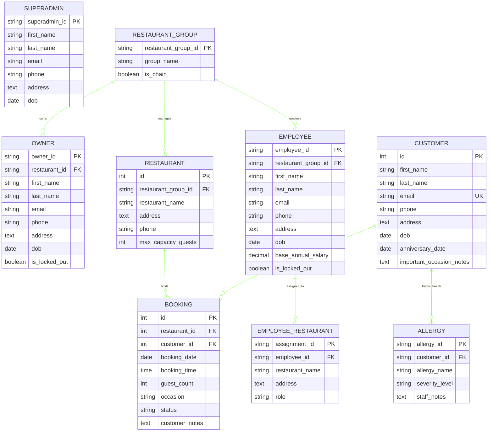

# 📊 Restaurant SaaS Platform - Database Schema Matrix

This flowchart maps out the relational database tables live inside your **PostgreSQL Cluster**, tracking core business operations, user roles, security rules, and customer CRM notes.

### 📐 Visual Entity-Relationship Diagram

